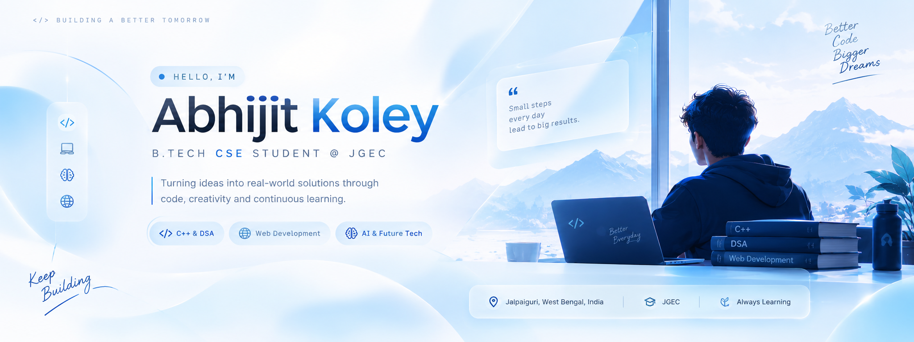

<!-- Premium Light Glassmorphism GitHub Profile -->

  

<h1 align="center">Hi 👋, I'm Abhijit Koley</h1>

<h3 align="center">B.Tech CSE Student @ JGEC 🎓</h3>

 Turning ideas into real-world solutions through code, creativity and continuous learning. 

     

## 👨‍💻About Me
🎓 *B.Tech Computer Science Engineering student at Jalpaiguri Government Engineering College.*

📍 Jalpaiguri, West Bengal, India

💻 Exploring C++, Data Structures & Algorithms

🌐 Learning Web Development

🤖 Interested in AI and future technologies

🌱 Always learning, building, and improving

## ⚙️Tools & Technologies

  

### Building ideas into experiences.

[GitHub](https://github.com/akoley713-ui) · C++ & DSA · Web Development · Exploring AI

 

---

## 🧑‍💻About Me

<table>
<tr>
<td width="60%" valign="top">

### 👋A little about my journey

I'm a B.Tech Computer Science Engineering student interested in software development, problem-solving, and building useful digital experiences.

- **Currently learning:** C++, DSA, HTML, CSS and JavaScript
- **Building:** Web interfaces and personal projects
- **Exploring:** AI-powered applications and modern web experiences
- **Working toward:** Strong programming fundamentals and software engineering skills

</td>
<td width="40%" valign="top">

### 🎯My focus

| Area | Focus |
|:--|:--|
| Programming | C++ |
| Problem solving | DSA practice |
| Web | HTML, CSS, JavaScript |
| Exploration | AI-powered products |

</td>
</tr>
</table>

---

## 📂Selected Projects

<table>
<tr>
<td width="50%" valign="top">

### 🌦️WeatherGPT

**Weather Assistant Experience**

A weather assistant concept with dedicated experiences for farmers, fishermen, and general users.

`Web Development` · `Weather`

[View Repository →](https://github.com/akoley713-ui)

### ⌨️Login Page

Responsive Login Interface

A login page built as an HTML web development project.

[View Repository →](https://github.com/akoley713-ui/Login-page-as-a-HTML-project)

### ⌚TIMELESS — Atelier

**Scroll-Driven Watch Experience**

A premium product-marketing website in progress, exploring cinematic frame-based scrolling and visual storytelling.

`Web Design` · `JavaScript`

[View repository →](https://github.com/akoley713-ui/timeless-scroll-experience)

</td>
</tr>
</table>

---

### ❤️Build. Learn. Improve.

*One project and one problem at a time.*

[Explore my repositories](https://github.com/akoley713-ui?tab=repositories)

Designed with a minimal, light-blue developer aesthetic.

